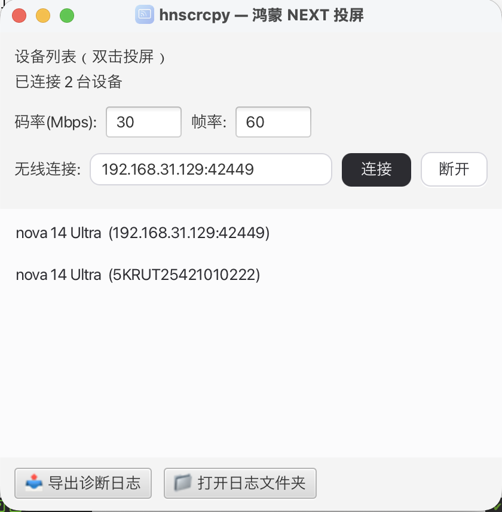
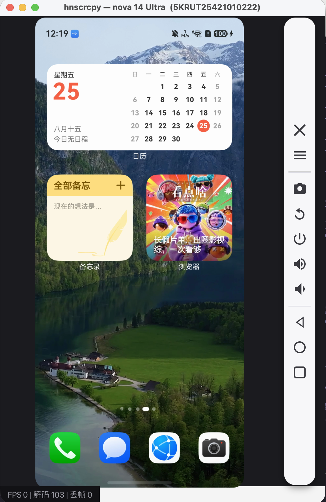
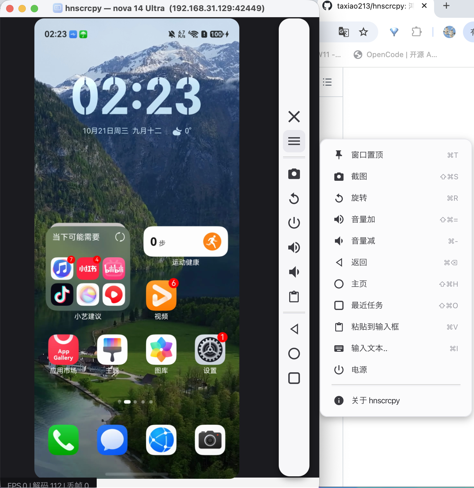
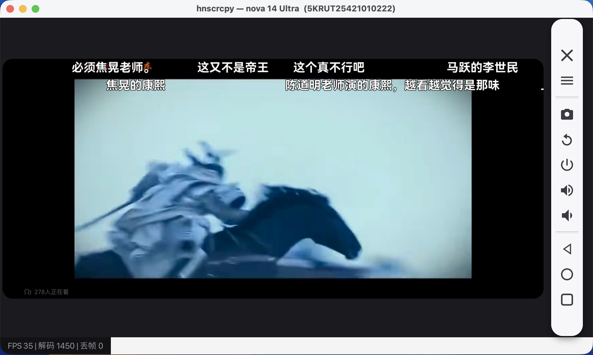

# hnscrcpy

鸿蒙 NEXT（HarmonyOS NEXT）投屏远控桌面工具 —— 类似 scrcpy 的体验：
打开即用，无需安装 Java / hdc / 任何环境，即可将设备屏幕实时镜像到
Windows / macOS / Linux 窗口，并用键鼠远程操作。

- 视频源：hosScrcpy H.264 流（gRPC over hdc forward，按屏幕变化推流）
- 解码：FFmpeg/avcodec 多线程直解（零 demuxer 延迟，环形缓冲零拷贝渲染）
- 技术栈：Java 17 + JavaFX 21 + JavaCPP(FFmpeg) + 内置 HDC
- 平台：Windows x64、macOS arm64、macOS x86_64、Linux x86_64
- **零外部依赖**：JRE、hdc（四平台）、hosScrcpy 全部内置在应用包中

## 软件截图

| 主界面：设备自动发现，双击投屏 | 竖屏投屏 + 侧边悬浮工具栏 |
|:---:|:---:|
|  |  |

| 快捷菜单：置顶/截图/旋转/音量/导航键 | 竖屏视频播放：高负载零丢帧 |
|:---:|:---:|
|  |  |

| 横屏视频播放：窗口自动跟随旋转 | |
|:---:|:---:|
|  | |

## 功能

- 设备列表自动发现（USB / 无线调试真机），双击投屏，支持多台设备同时投屏
- 实时镜像（60fps 配置上限，H.264 硬编），窗口等比缩放
- 远控：左键触摸（含长按）、右键/中键鼠标事件、滚轮、拖拽
- **键盘输入**：投屏窗口聚焦后直接打字，英文/数字实时注入手机输入框；Enter/退格/方向键走 uinput
- **中文输入**：菜单「输入文本…」（⌘I）呼出文本框，完整支持中文输入法与多行编辑，回车整段注入
- **粘贴到手机**：复制电脑文本 → 点击投屏画面 → ⌘V 或工具条「粘贴到输入框」按钮，整段注入设备输入框
- 快捷键（macOS ⌘ / Win·Linux Ctrl）：`⌘T` 窗口置顶、`⇧⌘S` 截图、`⌘R` 旋转、`⌘I` 输入文本、`⌘V` 粘贴、`⇧⌘=` 音量加、`⌘-` 音量减、`⌘⌫` 返回、`⇧⌘H` 主页、`⇧⌘O` 最近任务
- 右侧悬浮工具条：截图 / 旋转 / 电源 / 音量± / 粘贴 / 返回·主页·最近任务；☰ 菜单含输入文本、置顶与关于
- 截图保存到 `~/Pictures/hnscrcpy/`
- 设备旋转自适应（横竖屏切换窗口与坐标自动跟随）
- 断流自动重连（指数退避 + 看门狗，状态栏可见重连进度）
- CLI：`--serial / --bit-rate / --fps / --no-control`（`--help` 查看全部）

## 连接设备

**USB 连接（推荐，延迟最低）**：手机开启 USB 调试后插线，设备列表自动出现，双击投屏。

**无线调试**：手机与电脑处于同一 WLAN。

**方式一（推荐）：界面内直接连接** — 主界面码率/帧率下方的「无线连接」输入框填入手机显示的 `IP:端口`，点「连接」（或按回车）。连接成功后设备列表自动出现，地址会记住供下次使用。

**方式二：命令行连接**：

1. 手机：设置 → WLAN / 更多连接 → **无线调试**，开启后记下页面显示的 `IP:端口`
2. 电脑执行（hnscrcpy 内置 hdc，位于 `~/.hnscrcpy/tools/<平台>/hdc`，或使用系统 hdc）：

   ```bash
   hdc tconn 192.168.x.x:port     # 端口以手机无线调试页显示为准
   ```

3. 设备列表出现该设备（串号即 `IP:端口` 格式），双击投屏；CLI `--serial` 同样使用该串号：

   ```bash
   hnscrcpy --serial 192.168.x.x:port
   ```

> 无线模式带宽受 WLAN 限制，高帧率场景建议优先 USB。

## 下载

GitHub [Releases](https://github.com/taxiao213/hnscrcpy/releases) 提供四平台安装包
（打 `v*` tag 由 CI 自动构建发布）：

| 平台 | 产物 |
|------|------|
| macOS Apple Silicon | `hnscrcpy-v<版本>-macOS-arm64.dmg` |
| macOS Intel | `hnscrcpy-v<版本>-macOS-x86_64.dmg` |
| Windows x64 | `hnscrcpy-v<版本>-windows-x64-setup.exe` |
| Linux x86_64 | `hnscrcpy-v<版本>-linux-x64.deb` / `.tar.gz` 免安装包 |

> macOS 首次打开如提示"未受信任的开发者"：右键 → 打开。

## 从源码构建

```bash
mvn javafx:run                 # 开发模式
mvn test                       # 单元测试（含 golden 样本解码）
./scripts/build-package.sh     # macOS/Linux 出包（target/dist/）
scripts\build-package.ps1      # Windows 出包
```

本地构建默认产出免安装 app-image；`INSTALLER=1` 额外生成安装包（dmg/exe/deb）。

CLI 示例：

```bash
hnscrcpy --serial 5KRUT25421010222 --bit-rate 30 --fps 60
hnscrcpy --no-control          # 只看不控
```

## 文档

| 文档 | 内容 |
|------|------|
| [docs/PRD.md](docs/PRD.md) | 产品需求、功能清单、CLI 设计 |
| [docs/ARCHITECTURE.md](docs/ARCHITECTURE.md) | 架构设计、模块划分、数据流、风险 |
| [docs/TASKS.md](docs/TASKS.md) | 里程碑任务分解（M0–M6 全部完成） |
| [docs/HOS_SCRCPY_PROTOCOL.md](docs/HOS_SCRCPY_PROTOCOL.md) | hosScrcpy 协议逆向结论（M0）、文本注入通道与 XPM 兼容性（§10） |

## 状态

**v1.0.2（2026-10-21）**：M0–M6 全部完成，真机验证通过。新增键盘输入 / 中文输入（⌘I 文本对话框）/ 剪贴板粘贴到手机 / 无线连接输入框；详见 [docs/RELEASE_NOTES_v1.0.2.md](docs/RELEASE_NOTES_v1.0.2.md)。

- 视频管线：gRPC 流 → avcodec 多线程直解 → 环形缓冲零拷贝渲染，高负载实测 50–57fps 零丢帧
- 远控：触摸/鼠标/滚轮/按键（uitest 通道 + uinput）真机验证，横竖屏坐标自适应
- 打包：jpackage（dmg/exe/deb），GitHub Actions 四平台 CI，tag 触发自动发布
- 测试：117 个单元测试（UI/会话装配层由真机冒烟验证）

## 已知限制

- 视频恒为设备原始分辨率（自适应降采样仅作用于渲染输出）
- 不支持鸿蒙模拟器；真机支持 USB 与无线调试两种连接（无线可在主界面输入 `IP:端口` 直接连接）
- 音频转发暂不支持（hosScrcpy 无音频通道）

## 开源许可

hnscrcpy 自有代码以 **[Apache License 2.0](LICENSE)** 授权，`Copyright 2026 taxiao (https://github.com/taxiao213)`。

**使用与分发的几点要求**：

- **保留署名**：再分发或制作衍生品时，必须保留 `LICENSE` 与 [THIRD-PARTY-NOTICES.md](THIRD-PARTY-NOTICES.md) 的原文及作者署名；不得以「hnscrcpy 作者/官方」名义为衍生品背书（Apache-2.0 不授予商标使用权）
- **免责**：本软件按「现状」提供，不承诺可用性或不间断运行；使用投屏与远控功能产生的一切后果由使用者自行承担
- **内置华为组件（重要）**：本工具内置的 `hosScrcpy` jar 与 `hdc` 二进制版权归 **华为** 所有，**不在本项目 Apache-2.0 授权范围内**，未获华为再分发授权。本项目仅供**个人学习与研究**，**禁止商用**；如需商业用途，请自行向华为获取授权。如权利人认为分发方式不当，请联系作者，将立即移除

第三方依赖（FFmpeg、JavaFX 等）的许可信息详见 [THIRD-PARTY-NOTICES.md](THIRD-PARTY-NOTICES.md)。

## 作者与联系

| 渠道 | 信息 |
|------|------|
| **作者** | taxiao |
| **微信公众号** | 他晓 |
| **邮箱** | yin13753884368@163.com |
| **CSDN** | <http://blog.csdn.net/yin13753884368/article> |
| **GitHub** | <https://github.com/taxiao213> |

> 💬 **进群交流**：扫码添加个人微信，回复「**他晓**」即可进群。

| 微信公众号「他晓」 | 个人微信（回复「他晓」进群） |
|:---:|:---:|
|  |  |
